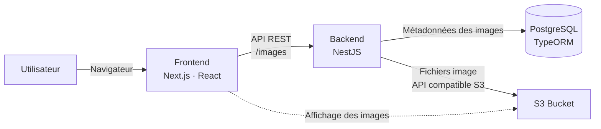

## Architecture



Le backend reçoit les images, en extrait les dimensions avec Sharp, stocke les fichiers dans MinIO et conserve leurs métadonnées dans PostgreSQL.

## Stack technique

- **Frontend :** Next.js 16, TypeScript, Tailwind CSS
- **Backend :** NestJS
- **Données :** PostgreSQL et TypeORM
- **Fichiers :** MinIO Locale, compatible avec l’API Amazon S3
- **Outils :** Bun et Docker Compose

## Démarrage local

Prérequis : Docker et Docker Compose.

```bash
docker compose up
```

- Frontend : [http://localhost:3001](http://localhost:3001)
- API : [http://localhost:3000](http://localhost:3000)
- Console MinIO : [http://localhost:9001](http://localhost:9001)

Docker Compose démarre le frontend, le backend, PostgreSQL et MinIO. Les données de PostgreSQL et de MinIO sont conservées dans des volumes Docker.